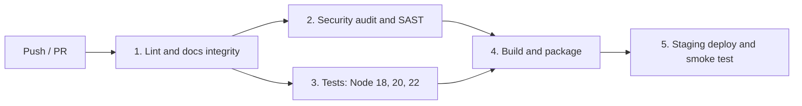

# IT Infrastructure Management Software

**Team 03 · SE Project 2026 · Section B**

A web-based system for an IT department to manage hardware assets, software licenses, endpoint compliance and procurement, with a REST API, a browser dashboard and a CI/CD pipeline that verifies every documented requirement.

[](https://github.com/SE-Project-2026-B-sec/Team-03---IT-infrastructure-management-software/actions/workflows/ci-cd.yml)

## What it does

| Area | Capabilities |
| :--- | :--- |
| Hardware assets | Register devices with auto-generated tags, Code 128 barcode labels and scan lookup, check-out/check-in with history, straight-line and written-down-value depreciation, maintenance log, NIST SP 800-88 decommissioning |
| Software licenses | License pools with seat limits, AES-256-GCM encrypted product keys (masked in every response), seat allocation that cannot over-allocate, reclaim on decommission |
| Endpoint compliance | Authenticated agent API for installed-software manifests, reconciliation against entitlements, prohibited-software incidents, license-breach alerts |
| Procurement | Requisitions, Manager → IT Director → Finance approval with separation of duties, purchase orders, automatic onboarding of deliveries |
| Alerts and reports | Expiry alerts at 60/30/7 days, compliance report in JSON or CSV with a SHA-256 integrity hash |
| Security | JWT authentication, role-based access control (8 roles), login lockout and rate limiting, strict input validation, security headers, TLS 1.3, hash-chained audit trail |
| Interface | Role-aware web app with sidebar navigation, overview charts, asset detail panel, approval steppers and in-place actions; light and dark themes; responsive to phone width; WCAG 2.1 AA contrast verified by tests |

## Documentation

| Document | Contents |
| :--- | :--- |
| [Software Requirements Specification](docs/SRS_IT_Infrastructure_Management.docx) | 16 functional, 6 non-functional and 5 security requirements, 4 security objectives, 2 use-case diagrams, traceability matrix |
| [Software Architecture and Design](docs/SAD_IT_Infrastructure_Management.docx) | Class and module diagrams, architecture decisions, STRIDE threat model, 3 sequence diagrams, REST API with real request/response examples |
| [Software Test Plan](docs/Test_Plan_IT_Infrastructure_Management.docx) | Strategy, entry/exit criteria, 27 test cases mapped to every requirement |

The three documents above are the submission copies, in the prescribed Word format. Their editable Markdown source lives in [`docs/source/`](docs/source) and is what the traceability check parses.

Traceability is enforced, not just documented: `npm run check:docs` fails if any requirement lacks a design spec or test case, or any test case lacks an automated test.

## Quick start

Requires **Node.js 18.18 or later**. The application has **no runtime dependencies**.

**See it with realistic data (recommended for evaluation):**

```bash
npm run demo
```

This starts an in-memory instance pre-filled through the real services: about 40 devices across every lifecycle state, nine license pools (including a seat deficit, an expired pool and renewals coming due), a prohibited-software incident, maintenance history, decommissioning certificates and purchase requests at every approval stage. Open http://localhost:3000 and sign in with any demo account below. The data resets when you stop the server.

**Start an empty instance:**

```bash
npm start
```

Without configuration the server keeps data in memory and generates temporary secrets (it logs a warning). For persistent data, set `DATA_FILE` and the secrets listed under [Configuration](#configuration).

### Using the dashboard

- Sign in with a demo role (the chips on the sign-in screen fill the username). Each role sees different navigation and actions; try `itadmin`, `manager`, `finance`, `auditor` and `employee`.
- Press `/` to search for an asset tag, or scan a barcode label into the search box.
- Select any asset row to open its detail panel: barcode label, depreciation, assignment history, maintenance, and check-out / check-in actions.
- Procurement shows each request's approval stepper; approvers see Approve / Reject on requests at their stage.
- The theme follows your OS setting; use the moon/sun button to switch. Sessions are held in memory only, so reloading the page signs you out.

### Demo accounts

Created on first start, one per role. Password: `ChangeMe!2026` (override with `DEMO_PASSWORD`, disable with `SEED_DEMO_USERS=false`).

| Username | Role | Username | Role |
| :--- | :--- | :--- | :--- |
| `superadmin` | Super Administrator | `director` | IT Director |
| `itadmin` | IT Administrator | `finance` | Finance Officer |
| `technician` | IT Technician | `auditor` | Auditor |
| `manager` | Manager | `employee`, `employee2` | Employee |

### Try the API

```bash
TOKEN=$(curl -s -X POST localhost:3000/api/v1/auth/login -H 'Content-Type: application/json' \
  -d '{"username":"itadmin","password":"ChangeMe!2026"}' | node -pe 'JSON.parse(require("fs").readFileSync(0)).accessToken')

curl -s -X POST localhost:3000/api/v1/assets -H "Authorization: Bearer $TOKEN" -H 'Content-Type: application/json' \
  -d '{"serialNumber":"5CD1234XYZ","model":"Latitude 5430","category":"LAPTOP","purchaseCost":1250}'
```

The full endpoint list is in SAD section 4.3.

## Development

```bash
npm ci              # installs the development tools (ESLint)
npm test            # all automated tests (node:test, no extra libraries)
npm run lint        # ESLint, zero warnings allowed
npm run sast        # ESLint security rules
npm run check:docs  # documentation and traceability check
npm run coverage    # tests with a coverage report
npm run build       # assemble dist/ with SHA-256 checksums in BUILD_INFO.json
```

Test names start with their test case ID (for example `TC-SAM-02`), so a failure points straight to the requirement it verifies.

## CI/CD pipeline

[`.github/workflows/ci-cd.yml`](.github/workflows/ci-cd.yml) runs on every push and pull request to `main` or `master`.



| Stage | What it checks | Fails when |
| :--- | :--- | :--- |
| 1. Lint and documentation | `node --check` on every file, ESLint, `check:docs` | Syntax error, any lint warning, broken traceability |
| 2. Security | `npm audit` (runtime: moderate+, tooling: high+), ESLint security rules, CodeQL on public repositories | Vulnerable dependency or security finding |
| 3. Tests | All 27 test cases on Node 18, 20 and 22 with runtime dependencies only; TAP results and coverage uploaded; job summary generated from the real results | Any test fails |
| 4. Build | Builds `dist/`, packages a tarball with `SHA256SUMS` | Missing build input |
| 5. Staging (push only) | Unpacks the exact tarball from stage 4 after verifying its checksum, starts it in production mode with fresh secrets, runs `scripts/smoke.js`, sends SIGTERM and checks exit code 0 and persisted data | Service not ready, smoke check fails, unclean shutdown |

## Configuration

All settings are environment variables; see [`.env.example`](.env.example).

| Variable | Purpose |
| :--- | :--- |
| `PORT`, `HOST` | Listen address (default `3000`, `0.0.0.0`) |
| `NODE_ENV=production` | Refuses to start unless the three secrets below are set |
| `JWT_SECRET`, `LICENSE_KEY_SECRET`, `AGENT_API_KEY` | Token signing key, product-key encryption key, endpoint agent key |
| `DATA_FILE` | JSON snapshot file for persistence |
| `BACKUP_DIR`, `BACKUP_SECRET` | Encrypted backups (`npm run backup` / `npm run restore -- <file>`) |
| `TLS_CERT_FILE`, `TLS_KEY_FILE`, `HTTP_REDIRECT_PORT` | Serve HTTPS (TLS 1.3 only) and redirect plain HTTP |
| `RATE_LIMIT_PER_MINUTE` | Per-client API request limit (default 600) |
| `LOG_LEVEL`, `SCHEDULE_JOBS` | Logging level; daily expiry check on/off |

## Project structure

```text
src/
  app.js, index.js, config.js, routes.js   composition root, entry point, configuration, REST routes
  http/        router, JSON body reader, responses and security headers, static files
  services/    users, hardware, barcode, licenses, compliance, procurement, alerts, notifications, reports
  security/    jwt, passwords (scrypt), vault (AES-256-GCM), rate limiter, RBAC matrix
  store/       in-memory store with indexes and snapshots, hash-chained audit log, backups
  lib/         validation, errors, logging, utilities
public/        dashboard: index.html, styles.css (design tokens), app.js (views, charts, dialogs), fonts/ (Inter, OFL)
scripts/       demo data, build, smoke test, backup/restore, documentation check, CI summary
tests/         one file per area; test names start with TC IDs
docs/          SRS, SAD, STP
```

## Limitations

Stated honestly so evaluators know what is and is not in v1.0: the endpoint agent program is not included (its API is implemented and tested with simulated agents); notifications are in-app only (no email); users are managed in the system (no LDAP); reports are JSON/CSV (no PDF); the store is single-node and in-memory, verified at 50,000 assets and 100,000 license seats. See SAD section 4.6 for next steps.

## Pushing to the team repository

```bash
git init
git add .
git commit -m "IT Infrastructure Management Software v1.0"
git branch -M main
git remote add origin https://github.com/SE-Project-2026-B-sec/Team-03---IT-infrastructure-management-software.git
git push -u origin main
```

If the push is rejected because the GitHub repository already has commits (for example a README created on GitHub), merge them instead of force-pushing, then push again:

```bash
git pull origin main --allow-unrelated-histories
git push -u origin main
```

Then open the **Actions** tab to watch the pipeline.

## License

[MIT](LICENSE). The bundled Inter typeface (`public/fonts/`) is licensed under the SIL Open Font License 1.1; see `public/fonts/OFL-LICENSE.txt`.
