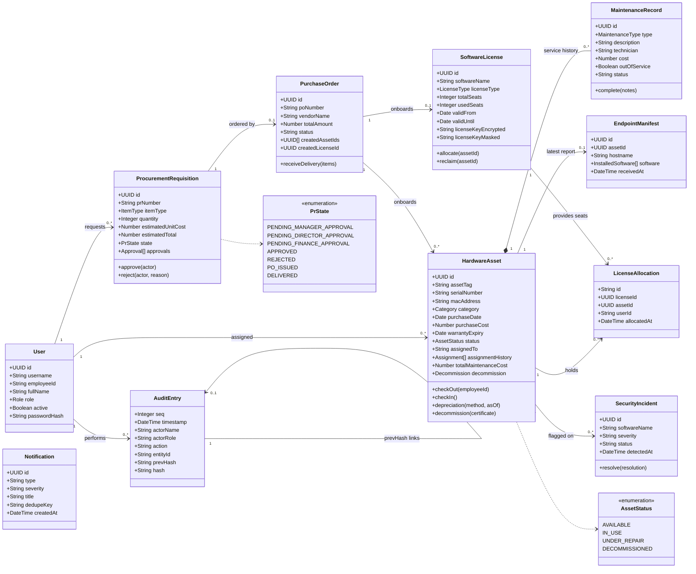
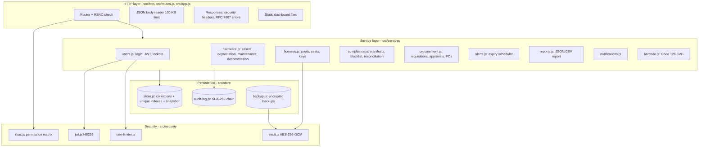
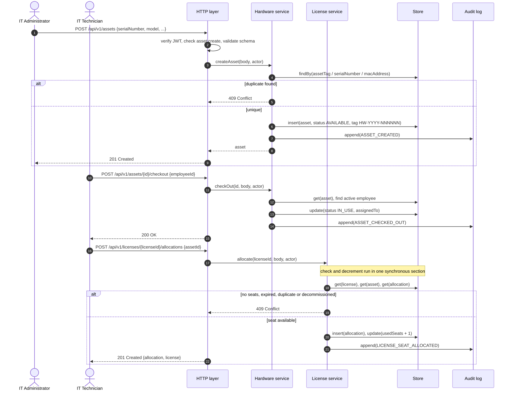
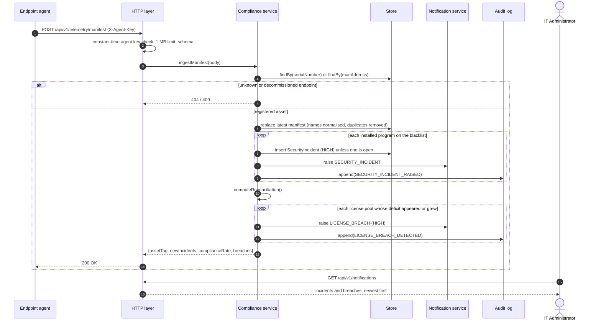
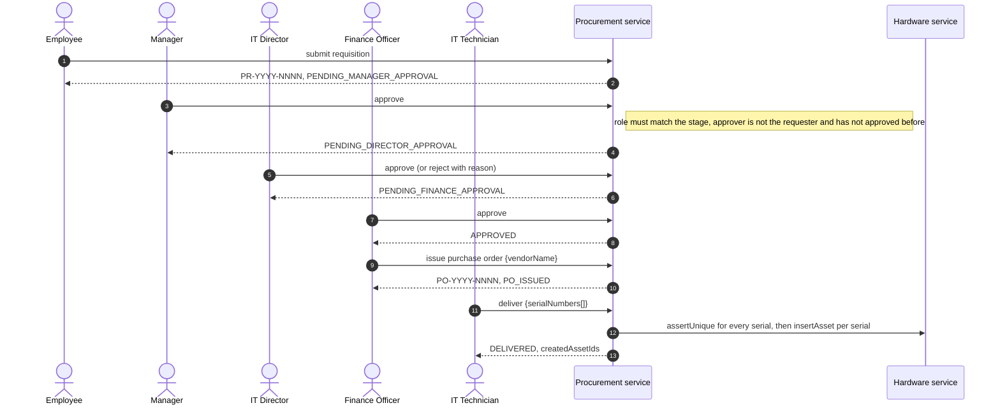

# Software Architecture and Design Specification (SAD)

**Project:** IT Infrastructure Management Software
**Version:** 2.0
**Authors:** Team 03 (SE Project 2026, Section B)
**Date:** 22-10-2026
**Status:** Baseline for evaluation
**Repository:** [SE-Project-2026-B-sec/Team-03---IT-infrastructure-management-software](https://github.com/SE-Project-2026-B-sec/Team-03---IT-infrastructure-management-software)

### Revision History

| Version | Date | Author | Change Summary |
| :--- | :--- | :--- | :--- |
| 1.0 | 22-10-2026 | Team 03 | Initial architecture draft |
| 2.0 | 22-10-2026 | Team 03 | Architecture rewritten to describe the implemented system; design spec IDs added for traceability; API examples taken from the running service |

### Approvals

| Role | Name | Signature/Date |
| :--- | :--- | :--- |
| Course Coordinator | | |
| Team 03 Lead / Architect | Dilipan Y | |

---

## 1. Introduction

### 1.1 Purpose

This document specifies the architecture and design of the IT Infrastructure Management Software (ITIM) v1.0: its components, data model, security architecture, key interaction flows and REST interface. It translates the requirements of the SRS into a design that the code in `src/` implements.

### 1.2 Scope

Hardware asset lifecycle, software license management, endpoint compliance auditing, procurement workflow, alerting and reporting, as scoped in SRS section 1.2.

### 1.3 Audience

Developers, QA engineers, security reviewers, course evaluators and operators.

### 1.4 Definitions

ADR (Architecture Decision Record), CSP (Content-Security-Policy), GCM (Galois/Counter Mode), HSTS (HTTP Strict Transport Security), JWT, RBAC, RPO/RTO, STRIDE (Spoofing, Tampering, Repudiation, Information disclosure, Denial of service, Elevation of privilege).

---

## 2. Document Overview

### 2.1 How to use this document

Section 3 describes the architecture: data model, components, the chosen pattern, risks, traceability and the threat model. Section 4 describes the design: interaction flows, the REST API, error handling and the user interface.

### 2.2 Related Documents

- [Software Requirements Specification](SRS_IT_Infrastructure_Management.md), including the RTM in section 8.
- [Software Test Plan](Test_Plan_IT_Infrastructure_Management.md).

---

## 3. Architecture

### 3.1 Goals & Constraints

**Goals**

- Correctness of license and asset state: no seat over-allocation, no illegal lifecycle transitions.
- Security by default: authenticated and authorised API, encrypted secrets, tamper-evident audit trail.
- Reproducible builds and tests: the service runs on a stock Node.js installation with no runtime dependencies, so CI and local runs behave identically.
- Performance and scale as specified in IT-NF-001 and IT-NF-003.

**Constraints**

- Node.js 18.18 or later; standard library only at runtime.
- Single-node deployment; the full data set is held in memory.
- Secrets supplied through environment variables.

### 3.2 Stakeholders & Concerns

| Stakeholder | Concerns |
| :--- | :--- |
| IT administrators and technicians | Fast tagging and lookup, accurate assignment history, simple seat allocation |
| Procurement and finance | Enforced approval order, separation of duties, traceable purchase orders |
| Compliance auditors | Accurate reconciliation, evidence that cannot be silently altered |
| Information security | Prohibited-software detection, key confidentiality, abuse resistance |
| Developers and evaluators | Modularity, testability, a CI pipeline that genuinely verifies the requirements |

### 3.3 Component (UML) Diagram

The class diagram shows the domain entities, their key attributes and associations. Enumerated status values are listed as stereotyped classes.



The module structure of the code:



### 3.4 Component Descriptions

| Component | Responsibility | Source |
| :--- | :--- | :--- |
| App / composition root | Loads configuration, builds services, creates the HTTP or HTTPS server, health probes, graceful shutdown | `src/app.js`, `src/index.js`, `src/config.js` |
| Router and HTTP layer | Route matching, authentication (JWT or agent key), RBAC check, JSON body parsing with size limit, security headers, RFC 7807 errors, static files with traversal protection | `src/routes.js`, `src/http/*` |
| User service | Demo user seeding, scrypt password verification, JWT issue/verify, login lockout | `src/services/users.js` |
| Hardware service | Asset registration and unique tags, check-out/in state machine, depreciation (SL/WDV), barcode labels, maintenance, decommissioning | `src/services/hardware.js`, `src/services/barcode.js` |
| License service | License pools, encrypted keys and masking, atomic seat allocation and reclaim | `src/services/licenses.js` |
| Compliance service | Manifest ingestion, blacklist detection and incidents, reconciliation, breach alerts | `src/services/compliance.js` |
| Procurement service | Requisitions, three-stage approval with separation of duties, purchase orders, delivery onboarding | `src/services/procurement.js` |
| Alert and notification services | Daily and on-demand expiry checks with de-duplicated in-app notifications | `src/services/alerts.js`, `src/services/notifications.js` |
| Report service | Compliance report (JSON/CSV) with SHA-256 content hash; CSV formula-injection protection | `src/services/reports.js` |
| Store | In-memory collections with unique case-insensitive indexes; atomic JSON snapshot (write temp file, fsync, rename) | `src/store/store.js` |
| Audit log | Append-only, frozen, hash-chained entries with verification | `src/store/audit-log.js` |
| Backup | AES-256-GCM encrypted, checksummed backups and verified restore | `src/store/backup.js`, `scripts/backup.js`, `scripts/restore.js` |
| Dashboard | Single-page application shell with hash routing and six role-aware views, asset detail panel and form dialogs (native `<dialog>`), charts drawn with DOM/SVG; renders data with DOM APIs only; self-hosted Inter typeface | `public/` |

### 3.5 Chosen Architecture Pattern and Rationale

**Pattern: layered modular monolith.** Requests pass through the HTTP layer (authentication, authorisation, validation), then a service layer that holds all business rules, then a persistence layer. Services depend only on the layer below and on each other through a shared `services` registry, so each can be tested on its own.

**ADR-1: Modular monolith rather than microservices.** Microservices would add network hops, distributed transactions (for example allocating a seat while decommissioning an asset) and operational overhead that a single-department tool does not need. Module boundaries in code give most of the maintainability benefit.

**ADR-2: In-memory store with atomic JSON snapshots rather than an external database.** Chosen so the system and its 27 automated tests run anywhere with only Node.js installed, which makes the CI pipeline fully reproducible. Node.js executes each request handler's synchronous section without interruption, so the read-check-write sequence in seat allocation is atomic; TC-SAM-02 verifies this with concurrent requests. Trade-offs: single node, data must fit in memory (verified at 50,000 assets and 100,000 seats by TC-SCALE-01), and up to 200 ms of writes can be lost on a hard crash (IT-NF-006). The `Store` class is the only module that touches persistence, so it can later be replaced by a PostgreSQL implementation behind the same methods.

**ADR-3: Zero runtime dependencies.** JWT, AES-GCM, scrypt, Code 128 and routing use the Node.js standard library. This removes supply-chain risk from production; development tools (ESLint) are dev-only dependencies.

### 3.6 Technology Stack & Data Stores

| Concern | Choice |
| :--- | :--- |
| Runtime | Node.js 18.18+ (CI matrix 18, 20, 22), CommonJS modules |
| HTTP | `node:http` / `node:https` (TLS 1.3 minimum) |
| Cryptography | `node:crypto`: HMAC-SHA256 (JWT), scrypt (passwords), AES-256-GCM (keys, backups), SHA-256 (audit chain, report hash) |
| Data store | In-memory maps with unique indexes; JSON snapshot file (`DATA_FILE`); encrypted backups (`BACKUP_DIR`) |
| Frontend | Static HTML, CSS and vanilla JavaScript (no framework, no build step); CSS custom-property design tokens for light/dark themes; Inter variable font (SIL OFL) served locally because the CSP blocks external hosts |
| Testing | `node:test` and `node:assert` |
| Quality and security tooling | ESLint 9 with `eslint-plugin-security`, `npm audit`, CodeQL (public repositories) |
| CI/CD | GitHub Actions |

### 3.7 Risks & Mitigations

| Risk | Impact | Mitigation |
| :--- | :--- | :--- |
| Concurrent requests take the same last seat | License over-allocation | Allocation check and decrement run in one synchronous section; verified by a concurrency test |
| Data loss on crash | Lost recent changes | Snapshot within 200 ms of each change, written atomically; encrypted backups; flush on shutdown |
| Data set outgrows memory | Service cannot start | Verified capacity documented; `Store` abstraction allows a database-backed implementation |
| Leaked product keys | Licence abuse, vendor penalties | AES-256-GCM at rest, masking, reveal only for Super Admin, every reveal audited |
| Insider edits audit records on disk | Loss of accountability | Hash chain detects edits, re-hashing and deletions; head hash appears in every report so it can be recorded externally |
| Ephemeral secrets in development | Tokens and encrypted keys unusable after restart | Secrets are mandatory when `NODE_ENV=production`; a startup warning is logged otherwise |

### 3.8 Traceability to Requirements

Design spec (DS) IDs are referenced from the SRS RTM.

| Design Spec | Requirement | Component | Implementation | Interface |
| :--- | :--- | :--- | :--- | :--- |
| DS-HAM-01 | IT-F-001 | Hardware service | `createAsset`, `insertAsset`, unique store indexes | `POST /api/v1/assets` |
| DS-HAM-02 | IT-F-002 | Hardware service | `checkOut`, `checkIn` state machine | `POST /api/v1/assets/{id}/checkout`, `/checkin` |
| DS-HAM-03 | IT-F-003 | Barcode encoder, Hardware service | `renderLabelSvg` (Code 128-B), `findByTag` | `GET /api/v1/assets/{id}/label.svg`, `GET /api/v1/assets/by-tag/{tag}` |
| DS-HAM-04 | IT-F-004 | Hardware service | `computeDepreciation`, `yearsBetween` | `GET /api/v1/assets/{id}/depreciation` |
| DS-SAM-01 | IT-F-005 | License service, Vault | `createLicense`, `view` | `POST /api/v1/licenses`, `GET /api/v1/licenses` |
| DS-SAM-02 | IT-F-006 | License service | `allocate`, `reclaim` | `POST /api/v1/licenses/{id}/allocations`, `DELETE .../allocations/{assetId}` |
| DS-SAM-03 | IT-F-007 | Compliance service | `ingestManifest`, `computeReconciliation` | `POST /api/v1/telemetry/manifest`, `POST /api/v1/compliance/reconcile` |
| DS-SAM-04 | IT-F-008 | Compliance service | blacklist, `raiseIncident`, `resolveIncident` | `/api/v1/compliance/blacklist`, `/api/v1/compliance/incidents` |
| DS-PROC-01 | IT-F-009 | Procurement service | `createRequisition` | `POST /api/v1/procurement/requisitions` |
| DS-PROC-02 | IT-F-010 | Procurement service | `STAGES`, `assertCanDecide`, `approve`, `reject` | `POST .../requisitions/{id}/approve`, `/reject` |
| DS-PROC-03 | IT-F-011 | Procurement, Hardware, License services | `issuePurchaseOrder`, `receiveDelivery` | `POST .../requisitions/{id}/purchase-order`, `POST .../purchase-orders/{id}/deliver` |
| DS-AUD-01 | IT-F-012 | Compliance, Notification services | `reconcile` breach state | `GET /api/v1/notifications?type=LICENSE_BREACH` |
| DS-AUD-02 | IT-F-013 | Alert service | `runExpiryCheck`, `startScheduler` | `POST /api/v1/alerts/expiry/run` |
| DS-AUD-03 | IT-F-014 | Report service | `buildComplianceReport`, `toCsv`, `csvCell` | `GET /api/v1/compliance/report?format=json\|csv` |
| DS-MAINT-01 | IT-F-015 | Hardware service | `addMaintenance`, `completeMaintenance` | `POST /api/v1/assets/{id}/maintenance` |
| DS-MAINT-02 | IT-F-016 | Hardware, License services | `decommission`, `reclaimAllForAsset` | `POST /api/v1/assets/{id}/decommission` |
| DS-PERF-01 | IT-NF-001 | HTTP layer, Store | Indexed lookups, synchronous in-memory operations | All API endpoints |
| DS-REL-01 | IT-NF-002 | App | Health probes, error isolation in `handle`, `stop()` drain and flush, signal handlers | `/health/live`, `/health/ready` |
| DS-SCALE-01 | IT-NF-003 | Store | Unique indexes on tag, serial, MAC, username, employee ID; paginated search | `GET /api/v1/assets` |
| DS-AUDIT-01 | IT-NF-004 | Audit log | `AuditLog.append`, `verify`, frozen entries | `GET /api/v1/audit`, `GET /api/v1/audit/verify` |
| DS-UX-01 | IT-NF-005 | Dashboard | `public/index.html`, `styles.css`, `app.js` | `/` |
| DS-DR-01 | IT-NF-006 | Store, Backup | `flushSync` (atomic), `createBackup`, `restoreBackup` | `npm run backup`, `npm run restore` |
| DS-SEC-01 | PRJ-SR-001 | App | HTTPS server with `minVersion: 'TLSv1.3'`, HSTS, redirect listener | `TLS_CERT_FILE`, `TLS_KEY_FILE`, `HTTP_REDIRECT_PORT` |
| DS-SEC-02 | PRJ-SR-002 | User service, RBAC | `signToken`, `verifyToken`, `authenticate`, `PERMISSIONS` | `Authorization: Bearer`, all `/api/v1` routes |
| DS-SEC-03 | PRJ-SR-003 | Vault, License service | `createVault`, `maskKey`, `revealKey` | `GET /api/v1/licenses/{id}/key` |
| DS-SEC-04 | PRJ-SR-004 | Validator, HTTP layer, Dashboard | `validate`, `readJsonBody`, `SECURITY_HEADERS`, `serveStatic` | All endpoints |
| DS-SEC-05 | PRJ-SR-005 | Rate limiter, User service | `FailureLimiter`, `RequestLimiter` | `POST /api/v1/auth/login`, all `/api/v1` routes |

### 3.9 Security Architecture

Threat modelling with STRIDE. Each control is verified by the listed test case.

| Threat Category | Threat | Countermeasure | Verified by |
| :--- | :--- | :--- | :--- |
| **Spoofing** | An attacker impersonates a user or an endpoint agent. | scrypt-hashed passwords; HS256 JWT with signature, algorithm (`alg=none` rejected), expiry, issuer and audience checks; agent key compared in constant time; login lockout. | TC-SEC-02, TC-SAM-03, TC-SEC-05 |
| **Tampering** | Requests modify fields they should not (seat counts, roles), or data on disk is altered. | Strict schemas reject unknown fields; prototype-pollution keys rejected; TLS 1.3 in transit; audit chain detects edits to stored records; GCM authentication rejects modified ciphertext. | TC-SEC-04, TC-AUDIT-01, TC-SEC-03 |
| **Repudiation** | An approver denies approving a purchase or revealing a key. | Every state change is appended to the hash-chained audit log with actor, role, IP and timestamp; key reveals are logged separately. | TC-AUDIT-01, TC-SEC-03 |
| **Information Disclosure** | Product keys, internals or data leak to unauthorised users. | Keys encrypted at rest and masked in responses; reveal only for Super Admin; RBAC on reads; 500 responses carry no stack traces; CSP, `nosniff`, `X-Frame-Options`; static files confined to `public/`. | TC-SEC-03, TC-REL-01, TC-SEC-04 |
| **Denial of Service** | Floods of requests, password guessing or huge payloads. | Per-IP API rate limit; per-account and per-IP login lockout; 100 KB body limit (1 MB for manifests); request and header timeouts against slow clients. | TC-SEC-05, TC-SEC-04 |
| **Elevation of Privilege** | A user raises their own permissions or skips an approval stage. | Role read from the user store on every request (not trusted from the token); central permission matrix; stage-specific approver roles; separation of duties; disabled accounts rejected immediately. | TC-SEC-02, TC-PROC-02 |

---

## 4. Design

### 4.1 Design Overview

Each request runs through `handle()` in `src/app.js`: security headers, health probe short-circuit, static files, rate limit, route match, authentication, permission check, body parsing, then the service call. Services validate input against explicit schemas, enforce business rules, update the store, and append an audit entry. All state-changing service methods are synchronous, so each runs atomically with respect to other requests.

### 4.2 UML Sequence Diagrams

#### Sequence Diagram 1: Register a laptop, assign it and allocate a license seat



#### Sequence Diagram 2: Endpoint manifest ingestion, prohibited software and license breach



#### Sequence Diagram 3: Requisition approval and delivery onboarding



### 4.3 API Design

All endpoints are under `/api/v1`, accept and return JSON, and require `Authorization: Bearer <token>` unless noted. Errors use RFC 7807 problem details (section 4.4). Status codes common to all protected endpoints: 401 (missing or invalid token), 403 (role lacks permission), 429 (rate limited).

**Endpoint summary**

| Method and path | Permission | Purpose |
| :--- | :--- | :--- |
| `POST /auth/login` | public | Obtain an access token |
| `GET /auth/me`, `GET /dashboard/summary`, `GET /me/assets` | any role | Current user, overview, own devices |
| `GET /directory/employees` | asset:assign | Active people (employee ID, name, department) for assignment pickers |
| `POST /assets` | asset:create | Register asset |
| `GET /assets?status&category&q&page&pageSize` | asset:read | Search assets |
| `GET /assets/{id}`, `GET /assets/by-tag/{tag}`, `GET /assets/{id}/label.svg` | asset:read | Read, scan lookup, barcode label |
| `POST /assets/{id}/checkout`, `POST /assets/{id}/checkin` | asset:assign | Assignment |
| `GET /assets/{id}/depreciation?method&salvageValue&lifespanYears&rate&asOf` | asset:read | Depreciation |
| `GET`/`POST /assets/{id}/maintenance`, `POST /assets/{id}/maintenance/{mid}/complete` | asset:read / asset:maintain | Maintenance |
| `POST /assets/{id}/decommission` | asset:decommission | Decommission |
| `POST /licenses`, `GET /licenses`, `GET /licenses/{id}` | license:manage / license:read | License pools |
| `GET /licenses/{id}/key` | license:reveal-key | Reveal raw key |
| `GET`/`POST /licenses/{id}/allocations`, `DELETE /licenses/{id}/allocations/{assetId}` | license:read / license:allocate | Seats |
| `POST /telemetry/manifest` | agent key | Manifest ingestion |
| `GET`/`POST /compliance/blacklist`, `GET /compliance/incidents`, `POST /compliance/incidents/{id}/resolve` | compliance:read / compliance:manage | Blacklist and incidents |
| `GET /compliance/reconciliation` | compliance:read | Current reconciliation, computed without side effects (used by dashboards) |
| `POST /compliance/reconcile`, `GET /compliance/report?format=json\|csv` | compliance:manage / compliance:read | Reconciliation with breach alerts; audited report |
| `POST /alerts/expiry/run`, `GET /notifications` | alerts:run / notifications:read | Alerts |
| `POST /procurement/requisitions`, `GET /procurement/requisitions[/{id}]` | procurement:request / own or read-all | Requisitions |
| `POST /procurement/requisitions/{id}/approve`, `/reject` | stage role | Approval chain |
| `POST /procurement/requisitions/{id}/purchase-order` | procurement:order | Issue PO |
| `GET /procurement/purchase-orders[/{id}]`, `POST /procurement/purchase-orders/{id}/deliver` | read-all / procurement:receive | POs and delivery |
| `GET /audit`, `GET /audit/verify` | audit:read | Audit trail |
| `GET /admin/users` | admin:users | User list |

#### Component 1: Hardware Asset Management

**Register asset** — `POST /api/v1/assets`

Request:

```json
{
  "serialNumber": "5CD1234XYZ",
  "manufacturer": "Dell",
  "model": "Latitude 5430",
  "category": "LAPTOP",
  "purchaseDate": "2026-03-15",
  "purchaseCost": 1250,
  "warrantyExpiry": "2029-03-15",
  "macAddress": "00:1A:2B:3C:4D:5E",
  "specifications": { "cpu": "Intel Core i7-1265U", "ramGb": 16 }
}
```

Response `201 Created`:

```json
{
  "id": "adbf1287-3d33-4bdd-b31d-df2290a7b232",
  "assetTag": "HW-2026-000001",
  "serialNumber": "5CD1234XYZ",
  "manufacturer": "Dell",
  "model": "Latitude 5430",
  "category": "LAPTOP",
  "purchaseDate": "2026-03-15",
  "purchaseCost": 1250,
  "warrantyExpiry": "2029-03-15",
  "macAddress": "00:1A:2B:3C:4D:5E",
  "location": null,
  "specifications": { "cpu": "Intel Core i7-1265U", "ramGb": 16 },
  "status": "AVAILABLE",
  "assignedTo": null,
  "assignmentHistory": [],
  "totalMaintenanceCost": 0,
  "source": "MANUAL",
  "purchaseOrderId": null,
  "decommission": null,
  "createdAt": "2026-10-22T11:00:46.693Z",
  "updatedAt": "2026-10-22T11:00:46.693Z"
}
```

Errors: `400` validation failure (lists every problem in `errors`), `409` duplicate tag, serial number or MAC address, `403` caller is not an administrator.

**Check out asset** — `POST /api/v1/assets/{id}/checkout`

Request:

```json
{ "employeeId": "EMP-0101", "notes": "New starter laptop" }
```

Response `200 OK` (abridged; the full asset is returned):

```json
{
  "id": "adbf1287-3d33-4bdd-b31d-df2290a7b232",
  "assetTag": "HW-2026-000001",
  "status": "IN_USE",
  "assignedTo": "EMP-0101",
  "checkedOutAt": "2026-10-22T11:00:46.716Z",
  "assignmentHistory": [
    { "employeeId": "EMP-0101", "checkedOutAt": "2026-10-22T11:00:46.716Z", "notes": "New starter laptop" }
  ]
}
```

Errors: `404` asset or employee not found, `409` asset is not `AVAILABLE` (for example `"Asset cannot be checked out while IN_USE"`).

#### Component 2: Software License Management

**Allocate a seat** — `POST /api/v1/licenses/{licenseId}/allocations`

Request:

```json
{ "assetId": "adbf1287-3d33-4bdd-b31d-df2290a7b232" }
```

Response `201 Created` (license abridged):

```json
{
  "allocation": {
    "id": "2be5b7b0-be26-480f-89e5-b90587e2a06e:adbf1287-3d33-4bdd-b31d-df2290a7b232",
    "allocationId": "7101c03d-f397-4775-9910-09e81f5277c6",
    "licenseId": "2be5b7b0-be26-480f-89e5-b90587e2a06e",
    "assetId": "adbf1287-3d33-4bdd-b31d-df2290a7b232",
    "assetTag": "HW-2026-000001",
    "userId": "EMP-0101",
    "allocatedAt": "2026-10-22T11:00:46.720Z",
    "allocatedBy": "technician"
  },
  "license": {
    "id": "2be5b7b0-be26-480f-89e5-b90587e2a06e",
    "softwareName": "IntelliJ IDEA Ultimate",
    "totalSeats": 1,
    "usedSeats": 1,
    "availableSeats": 0,
    "licenseKeyMasked": "XXXX-XXXX-XXXX-9876",
    "hasKey": true
  }
}
```

Errors: `404` license or asset not found; `409` with one of: no available seats, asset already holds a seat, license expired, asset decommissioned.

```json
{
  "type": "/problems/conflict",
  "title": "Conflict",
  "status": 409,
  "detail": "No available seats: all 1 seats of IntelliJ IDEA Ultimate are allocated",
  "instance": "/api/v1/licenses/2be5b7b0-be26-480f-89e5-b90587e2a06e/allocations",
  "requestId": "de123613-94e4-42b7-8f10-cce52fe2576b"
}
```

#### Component 3: Endpoint Telemetry

**Submit manifest** — `POST /api/v1/telemetry/manifest` with header `X-Agent-Key`

Request:

```json
{
  "serialNumber": "5CD1234XYZ",
  "hostname": "eng-laptop-01",
  "agentVersion": "1.0.0",
  "installedSoftware": [
    { "name": "IntelliJ IDEA Ultimate", "version": "2026.2" },
    { "name": "BitTorrent.exe", "version": "7.11" }
  ]
}
```

Response `200 OK`:

```json
{
  "assetId": "adbf1287-3d33-4bdd-b31d-df2290a7b232",
  "assetTag": "HW-2026-000001",
  "softwareCount": 2,
  "newIncidents": [
    {
      "id": "0756a0f8-337e-4df1-bb4a-79978e510e57",
      "assetTag": "HW-2026-000001",
      "softwareName": "BitTorrent.exe",
      "normalizedName": "bittorrent",
      "classification": "PROHIBITED_SOFTWARE",
      "severity": "HIGH",
      "status": "OPEN",
      "recommendedAction": "Quarantine the endpoint and uninstall the prohibited software"
    }
  ],
  "complianceRate": 100,
  "breaches": []
}
```

Errors: `400` neither serial number nor MAC given, `401` missing or wrong agent key, `404` endpoint not registered, `409` asset decommissioned, `413` manifest larger than 1 MB.

#### Component 4: Procurement

**Approve a requisition** — `POST /api/v1/procurement/requisitions/{id}/approve`

Request:

```json
{ "comment": "Within team budget" }
```

Response `200 OK` (abridged):

```json
{
  "prNumber": "PR-2026-0001",
  "estimatedTotal": 900,
  "state": "PENDING_DIRECTOR_APPROVAL",
  "approvals": [
    { "stage": "PENDING_MANAGER_APPROVAL", "role": "MANAGER", "approverName": "Manu Manager", "comment": "Within team budget", "at": "2026-10-22T11:00:46.784Z" }
  ]
}
```

Errors: `403` wrong role for the stage (`"This stage requires the MANAGER role"`), own requisition, or already approved by this person; `404` not found; `409` not awaiting approval.

### 4.4 Error Handling, Logging & Monitoring

- **Errors:** every error is an RFC 7807 document with `type`, `title`, `status`, `detail`, `instance` and `requestId`; validation errors add an `errors` array; 429 responses add `Retry-After`. Unexpected exceptions are logged with their stack trace server-side and returned as a generic 500 with no internal detail.
- **Logging:** one JSON line per request (`timestamp`, `level`, `requestId`, `method`, `path`, `status`, `durationMs`, `userId`, `ip`) plus lifecycle events. Passwords, tokens and product keys are never logged. A caller-supplied `X-Request-Id` (8 to 64 safe characters) is propagated; otherwise one is generated.
- **Monitoring:** `/health/live` (process up) and `/health/ready` (accepting traffic, persistence healthy; 503 during shutdown or after a failed snapshot write). The business audit trail is separate from operational logs and can be verified at any time via `/api/v1/audit/verify`.

### 4.5 UX Design

**Structure.** A sign-in screen (brand panel plus sign-in card with one-click demo-role chips that fill the username) and an application shell: a sidebar with role-filtered navigation and badges (requests awaiting the user, high-severity alerts), a sticky top bar with the page title, a global asset-tag search (`/` shortcut, scanner friendly), the theme toggle and an alerts shortcut. Views are addressed by URL hash (`#/assets`), so links and the browser back button work.

**Views.**

| View | Content | Roles |
| :--- | :--- | :--- |
| Overview | Greeting with context ("1 request worth $4,798 needs your attention"), stat tiles, fleet-status stacked bar, compliance ring meter, seat-utilisation meters, recent alerts, requests waiting for the user, own devices | All (content varies by role) |
| Hardware assets | Search and filters, paginated table; selecting a row opens a side panel with the barcode label (downloadable), details, depreciation, assignment timeline and maintenance log, plus check-out / check-in / log-maintenance actions | IT staff, auditors |
| Software licenses | Summary tiles (pools, seat use, renewals due, expired), table with masked keys, seat meters and expiry badges; Super Admins can reveal a key (audited) | IT staff, auditors |
| Procurement | Filter chips (needs my action, in progress, delivered, rejected) and request cards with a six-step approval stepper and the actions valid for the user's role and the request's state | All |
| Compliance | Compliance ring, deficit / unlicensed / incident tiles, audit-chain integrity, reconciliation table, incidents with resolve action, JSON/CSV report download | Admins, auditors |
| Alerts | Filterable notification feed; admins can run the expiry check on demand | Admins, auditors |

**Visual language.** Design tokens (CSS custom properties) define surfaces, text, accent gradient (indigo to violet) and status colours for both themes; the dark theme is a selected palette, not an inversion. Inter is used for all text with tabular figures only in table columns. Cards use 18 px radii and soft layered shadows; motion is limited to short entrance and progress animations and is disabled under `prefers-reduced-motion`.

**Charts.** Chosen by the data's job: a stacked bar for the asset-status split (part-to-whole, fixed categorical colour order validated for colour-vision deficiency with a 2 px gap between segments), a ring meter for the single compliance ratio (same-hue track), linear meters for seat utilisation, and stat tiles for headline numbers. Every chart has a text equivalent (legend with counts and percentages, or the adjacent table), and chart marks show the same value on hover and keyboard focus.

**Feedback and states.** Toast messages in a polite live region confirm every action; dialogs validate required fields before submitting and show server validation messages inline; skeleton placeholders cover first loads and refreshes keep the previous content at reduced opacity instead of flashing.

**Accessibility.** Semantic landmarks, skip link, programmatic labels on every control, table captions and header scopes, native `<dialog>` for modals and the side panel (focus is trapped while open and returned afterwards), visible focus rings, an off-canvas mobile menu that is removed from the tab order when closed, text contrast of at least 4.5:1 (including tinted status pills) and graphics contrast of at least 3:1 in both themes, all verified by TC-UX-01.

### 4.6 Open Issues & Next Steps

- Implement the endpoint agent (Windows, macOS, Linux) against the documented telemetry API.
- Email and chat delivery of notifications (current delivery is in-app).
- LDAP / Active Directory single sign-on and user provisioning.
- PDF export of the compliance report.
- PostgreSQL implementation of the `Store` interface for multi-node deployments.
- Periodic external anchoring of the audit head hash (for example in a write-once store).

---

## 5. Appendices

### 5.1 Glossary

ITAM, HAM, SAM, CMDB, PR, PO, RBAC, JWT, TLS, HSTS, CSP, GCM, RPO, RTO, STRIDE, WCAG.

### 5.2 References

- ISO/IEC/IEEE 42010:2022 Architecture description.
- ISO/IEC 19770-1:2017 IT asset management.
- NIST SP 800-88 Rev. 1, Guidelines for Media Sanitization.
- OWASP Top 10 (2021) and OWASP ASVS 4.0.
- RFC 7519 (JWT), RFC 7807 (Problem Details), RFC 8446 (TLS 1.3).
- WCAG 2.1.

### 5.3 Tools

Mermaid (diagrams), Node.js test runner, ESLint, GitHub Actions.
