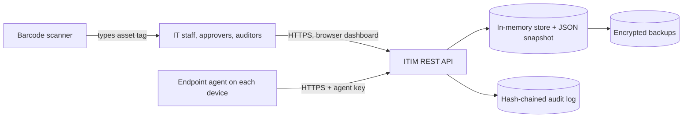
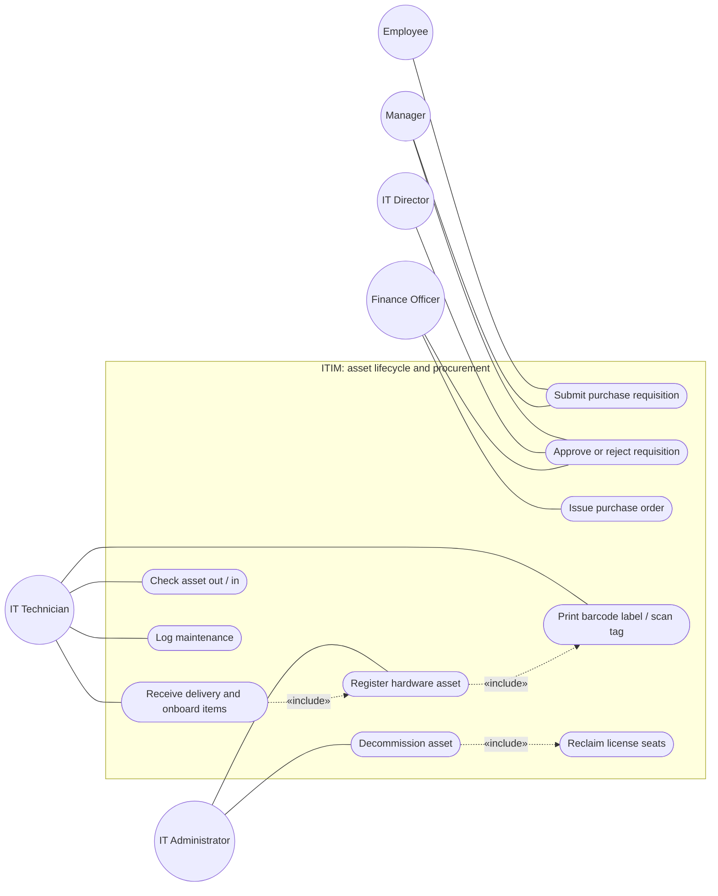
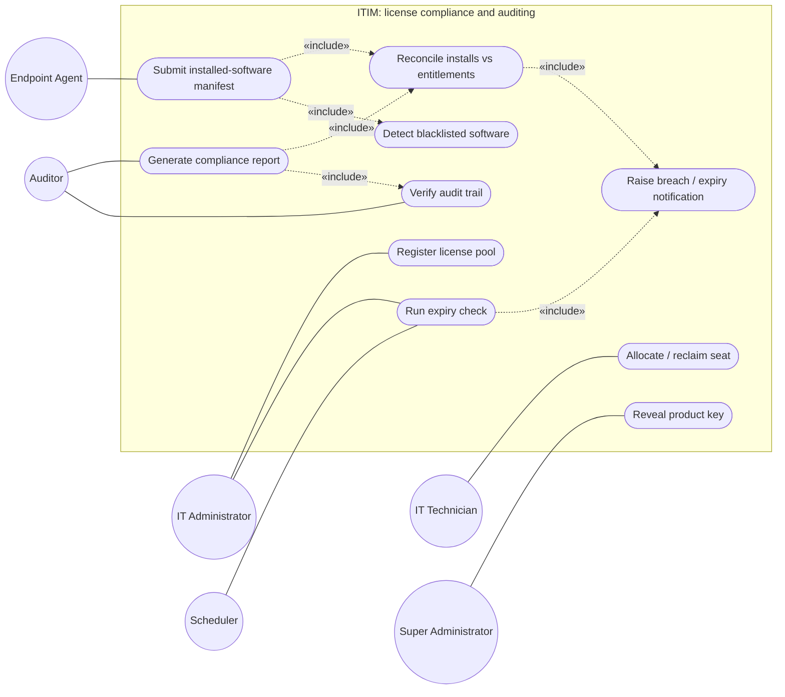

# Software Requirements Specification (SRS)

**Project:** IT Infrastructure Management Software
**Version:** 2.0
**Authors:** Team 03 (SE Project 2026, Section B)
**Date:** 22-10-2026
**Status:** Baseline for evaluation
**Repository:** [SE-Project-2026-B-sec/Team-03---IT-infrastructure-management-software](https://github.com/SE-Project-2026-B-sec/Team-03---IT-infrastructure-management-software)

### Revision history

| Version | Date | Author | Change summary | Approval |
| :--- | :--- | :--- | :--- | :--- |
| 1.0 | 22-10-2026 | Team 03 | Initial requirements draft | Superseded |
| 2.0 | 22-10-2026 | Team 03 | Requirements aligned with the implemented system; every requirement now has an automated test; RTM statuses reflect actual verification | Pending |

### Approvals

| Role | Name | Signature / Email | Date |
| :--- | :--- | :--- | :--- |
| Course Coordinator | | | |
| Team 03 Lead | Dilipan Y | | |

### Table of Contents

1. Introduction
2. Overall description
3. External interface requirements
4. System features (detailed)
5. Non-functional requirements (detailed)
6. Quality attributes & Acceptance tests
7. UML Use-Case Diagrams
8. Requirements Traceability Matrix (RTM)

---

## 1. Introduction

### 1.1 Purpose

This document specifies the functional and non-functional requirements of the IT Infrastructure Management Software (ITIM) v1.0. It is the agreement between the team, testers and evaluators about what the system does and how each requirement is verified. Every requirement has acceptance criteria and a test case reference; the test cases are defined in the Software Test Plan and implemented as automated tests in `tests/`.

### 1.2 Scope

ITIM is a web-based system for an organisation's IT department. It covers:

- **Hardware Asset Management (HAM):** registering devices, barcode labelling, check-out to employees and check-in, depreciation, maintenance history and certified decommissioning.
- **Software Asset Management (SAM):** license pools with seat limits, seat allocation to devices, encrypted storage of product keys.
- **Endpoint compliance auditing:** an authenticated REST endpoint that receives installed-software manifests from endpoint agents, reconciles installations against purchased entitlements and detects prohibited software.
- **Procurement:** purchase requisitions with a three-tier approval chain, purchase orders, and automatic onboarding of delivered items.
- **Alerting and reporting:** license-breach and expiry notifications, and one-click compliance reports in JSON and CSV.

**Out of scope for v1.0:** the endpoint agent program itself (the system defines and implements the agent API; tests use simulated agents), network discovery (SNMP/WMI sweeps), LDAP/Active Directory integration (users are managed in the system), email/Slack delivery of notifications (notifications are in-app), PDF export, and multi-node clustering.

### 1.3 Audience

Developers, QA engineers, IT administrators, procurement and finance staff, compliance auditors, and course evaluators.

### 1.4 Definitions

- **HAM / SAM:** Hardware / Software Asset Management.
- **Asset tag:** unique human-readable identifier of a device, for example `HW-2026-000042`.
- **License pool:** a purchased entitlement for one software product with a fixed number of seats.
- **Seat allocation:** assignment of one seat of a license pool to one hardware asset.
- **Manifest:** the list of installed software reported by an endpoint agent.
- **PR / PO:** Purchase Requisition / Purchase Order.
- **RBAC:** Role-Based Access Control. **JWT:** JSON Web Token. **TLS:** Transport Layer Security.
- **RPO / RTO:** Recovery Point Objective / Recovery Time Objective.
- **NIST SP 800-88:** NIST guideline for media sanitisation (methods Clear, Purge, Destroy).

---

## 2. Overall description

### 2.1 Product perspective

ITIM is a self-contained Node.js service exposing a REST API and serving a browser dashboard. Endpoint agents on company devices call the telemetry API. Data is held in memory and persisted to a JSON snapshot file, with encrypted backups.

### 2.2 Major product functions

1. Register hardware assets and print Code 128 barcode labels; resolve scanned tags.
2. Check devices out to employees and back in; keep assignment history.
3. Compute straight-line and written-down-value depreciation.
4. Maintain license pools with encrypted product keys; allocate and reclaim seats without over-allocation.
5. Ingest endpoint manifests; reconcile installations against entitlements; detect prohibited software.
6. Run purchase requisitions through Manager, IT Director and Finance approval; issue purchase orders; onboard deliveries.
7. Raise license-breach and expiry notifications; produce compliance reports.
8. Log maintenance; decommission devices with a sanitisation certificate and reclaim their licenses.

### 2.3 User roles and characteristics

| Role | Characteristics and main tasks |
| :--- | :--- |
| Super Administrator | Full access, including viewing raw license keys and the user list. |
| IT Administrator | Registers assets and licenses, decommissions devices, manages the blacklist, runs alert checks. |
| IT Technician | Day-to-day check-out/check-in, seat allocation, maintenance logging, receiving deliveries. |
| Manager | First-stage approver of requisitions. |
| IT Director | Second-stage approver of requisitions. |
| Finance Officer | Final approver; issues purchase orders. |
| Auditor | Read-only access to assets, licenses, compliance reports and the audit trail. |
| Employee | Sees assigned devices; submits and tracks own requisitions. |

### 2.4 Operating environment

- Server: Node.js 18.18 or later (tested on 18, 20 and 22) on Linux, macOS or Windows; no runtime npm dependencies.
- Client: current Chrome, Edge, Firefox or Safari.
- Barcode scanners: any USB or Bluetooth scanner in keyboard (HID) mode that reads Code 128.

### 2.5 Constraints

- Align asset and license records with ISO/IEC 19770-1 practices.
- Privacy: agents report installed software names, versions and publishers only; no personal files or browsing data are collected.
- Secrets (JWT key, license-key encryption key, agent key, backup key) are supplied through environment variables and are mandatory in production mode.
- Single-node deployment; the data set must fit in memory (see IT-NF-003 for the verified size).

---

## 3. External interface requirements

### 3.1 User interfaces

- Responsive browser dashboard (`/`) with a sidebar application shell and six role-aware views: Overview (stat tiles, fleet-status chart, compliance meter, seat utilisation, recent alerts, items awaiting the user's action), Hardware assets (searchable, filterable table with an asset detail panel showing the barcode label, depreciation, assignment and maintenance history, and check-out / check-in / maintenance actions), Software licenses (seat meters, masked keys, expiry badges), Procurement (requests with an approval stepper and approve / reject / purchase-order / delivery actions), Compliance (reconciliation table, incidents, audit-chain status, report downloads) and Alerts. Navigation and actions shown depend on the user's role; the server enforces every permission regardless.
- Global asset-tag search box that also accepts input from a barcode scanner (keyboard shortcut `/`).
- Light and dark themes following the operating-system setting, with an in-app toggle; layout adapts down to phone width.
- Accessibility: WCAG 2.1 AA practices (labels, skip link, landmarks, live status region, keyboard-operable dialogs, 4.5:1 text contrast and 3:1 graphics contrast in both themes); see IT-NF-005.

### 3.2 Hardware interfaces

- Barcode scanners in HID keyboard mode: the scanner types the asset tag into the scan box; labels use Code 128 (code set B).
- Label printers: labels are SVG and print at any size.

### 3.3 Software interfaces

- **REST API** (`/api/v1/...`): JSON request and response bodies; errors as RFC 7807 problem details. Defined in SAD section 4.3.
- **Endpoint agent API** (`POST /api/v1/telemetry/manifest`): authenticated with the `X-Agent-Key` header.
- **Exports:** compliance report as JSON or CSV.

### 3.4 Communications interfaces

- HTTPS with TLS 1.3 when a certificate is configured, plus an optional HTTP listener that only redirects to HTTPS (PRJ-SR-001). Without a certificate the service must run behind a TLS-terminating proxy.
- Health endpoints `/health/live` and `/health/ready` for load balancers and orchestrators.

---

## 4. System features (detailed)

Each requirement includes acceptance criteria and a reference test case. IDs follow IT-F-###. The system defines 16 functional requirements (template minimum: 15).

### 4.1 Hardware asset lifecycle

Description: track each device from registration to disposal.

| Req ID | Requirement (The system shall...) | Type | Priority | Source / Stakeholder | Acceptance criteria / Test case ref | Comments / Dependencies |
| :--- | :--- | :--- | :--- | :--- | :--- | :--- |
| **IT-F-001** | allow administrators to register a hardware asset with serial number (required), optional asset tag, manufacturer, model, category, purchase date and cost, warranty expiry, MAC address and specifications. | Functional | High | IT Administrator | AC-IT-F-001: Valid request returns 201 with status `AVAILABLE`; a unique tag `HW-YYYY-NNNNNN` is generated when none is given; duplicate tag, serial or MAC returns 409; invalid data returns 400; non-admin roles get 403. Test: TC-HAM-01 | Foundation for all other HAM features |
| **IT-F-002** | support check-out of an available asset to an active employee and check-in, recording the assignment history. | Functional | High | IT Technician | AC-IT-F-002: Check-out sets `IN_USE` and the employee ID; checking out an asset that is not `AVAILABLE` returns 409; unknown employee returns 404; check-in restores `AVAILABLE` and closes the history entry. Test: TC-HAM-02 | Depends on IT-F-001 and the user directory |
| **IT-F-003** | generate a printable Code 128 barcode label for each asset and resolve a scanned asset tag to the asset record. | Functional | Medium | IT Technician | AC-IT-F-003: The SVG label decodes to the asset tag; tag lookup is case-insensitive and returns the asset; an unknown tag returns 404. Test: TC-HAM-03 | Scanners act as keyboards (section 3.2) |
| **IT-F-004** | calculate depreciation by the straight-line (SL) or written-down-value (WDV) method as of a given date. | Functional | Medium | Finance | AC-IT-F-004: Cost 1200, salvage 200, life 5 years, age 2 years gives 200 per year and book value 800 (SL); WDV at 25% gives 675; book value never falls below salvage; a date before purchase or invalid parameters return 400. Test: TC-HAM-04 | Uses IT-F-001 purchase data |

### 4.2 Software license management

Description: keep purchased entitlements accurate and prevent over-use.

| Req ID | Requirement (The system shall...) | Type | Priority | Source / Stakeholder | Acceptance criteria / Test case ref | Comments / Dependencies |
| :--- | :--- | :--- | :--- | :--- | :--- | :--- |
| **IT-F-005** | maintain license pools recording software name, publisher, version, license type, total seats, validity period, cost per seat and product key. | Functional | High | IT Administrator | AC-IT-F-005: Valid request returns 201 with `availableSeats` equal to `totalSeats`; the key is returned only in masked form and stored encrypted; seat counts that are not positive integers return 400. Test: TC-SAM-01 | Key handling per PRJ-SR-003 |
| **IT-F-006** | allocate license seats to hardware assets and reclaim them, never allocating more seats than purchased. | Functional | High | IT Technician | AC-IT-F-006: Each allocation decrements available seats; allocation with no seats left, a duplicate allocation, an expired license or a decommissioned asset returns 409; 10 concurrent requests for 3 seats produce exactly 3 allocations; reclaiming frees the seat. Test: TC-SAM-02 | Depends on IT-F-001, IT-F-005 |
| **IT-F-007** | accept installed-software manifests from authenticated endpoint agents, match them to registered assets by serial number or MAC address, and reconcile installations against license entitlements. | Functional | High | Compliance Auditor | AC-IT-F-007: A valid manifest returns 200 with the matched asset and is reconciled in the same request (well within 60 seconds); duplicate entries are collapsed; an unregistered device returns 404; a missing or wrong agent key returns 401. Test: TC-SAM-03 | Agent API, section 3.3 |
| **IT-F-008** | detect blacklisted software in manifests and raise a high-severity security incident and notification; let administrators extend the blacklist and resolve incidents. | Functional | High | Information Security | AC-IT-F-008: A manifest containing `BitTorrent.exe` or `XMRig` creates one HIGH incident per program (matching ignores case and `.exe`); an open incident is not duplicated; newly blacklisted software is detected; resolving sets `RESOLVED`. Test: TC-SAM-04 | Depends on IT-F-007 |

### 4.3 Procurement workflow

Description: controlled purchasing from request to delivery.

| Req ID | Requirement (The system shall...) | Type | Priority | Source / Stakeholder | Acceptance criteria / Test case ref | Comments / Dependencies |
| :--- | :--- | :--- | :--- | :--- | :--- | :--- |
| **IT-F-009** | let users submit purchase requisitions for hardware or software licenses stating quantity, unit cost and business justification. | Functional | High | Employees, Managers | AC-IT-F-009: Valid request returns 201 with a number `PR-YYYY-NNNN`, state `PENDING_MANAGER_APPROVAL` and the computed total; invalid quantity, cost or justification returns 400; requesters see only their own requisitions; auditors cannot submit. Test: TC-PROC-01 | |
| **IT-F-010** | route each requisition through Manager, IT Director and Finance Officer approval in that order, allow rejection with a reason at any stage, and enforce separation of duties. | Functional | High | IT Director, Finance | AC-IT-F-010: Each stage accepts only its role (403 otherwise); the state reaches `APPROVED` only after all three approvals; requesters cannot approve their own requisition and no person approves twice; a rejected requisition cannot be approved. Test: TC-PROC-02 | |
| **IT-F-011** | let the Finance Officer issue one purchase order for an approved requisition and, on delivery, onboard the items automatically. | Functional | Medium | Finance, IT Technician | AC-IT-F-011: A PO `PO-YYYY-NNNN` is issued only for `APPROVED` requisitions and only once; delivering hardware creates one `AVAILABLE` asset per serial number linked to the PO; delivering software creates a license pool with the purchased seats. Test: TC-PROC-03 | Uses IT-F-001, IT-F-005 |

### 4.4 Compliance alerting and reporting

Description: tell the right people about risk and give auditors evidence.

| Req ID | Requirement (The system shall...) | Type | Priority | Source / Stakeholder | Acceptance criteria / Test case ref | Comments / Dependencies |
| :--- | :--- | :--- | :--- | :--- | :--- | :--- |
| **IT-F-012** | detect under-licensing (installations greater than purchased seats) and raise a high-severity breach notification when a deficit appears or grows. | Functional | High | Compliance Lead | AC-IT-F-012: Three installations against two seats produce exactly one HIGH `LICENSE_BREACH` notification with deficit 1 and an audit entry; re-running reconciliation without change raises nothing new. Test: TC-AUD-01 | Uses IT-F-007 data |
| **IT-F-013** | raise notifications 60, 30 and 7 days before and on expiry of each license and hardware warranty, once per threshold, by a daily job and on demand. | Functional | High | IT Operations | AC-IT-F-013: For an item expiring on 31-12-2026, checks on 01-11, 05-12 and 26-12 raise one LOW, MEDIUM and HIGH notification respectively, a repeat check raises nothing, and a check on 02-01-2027 raises an EXPIRED notification. Test: TC-AUD-02 | |
| **IT-F-014** | generate a compliance report on demand in JSON or CSV containing asset and seat totals, per-license reconciliation, open incidents, decommissioning certificates, audit-chain status and a SHA-256 content hash. | Functional | Medium | Auditor | AC-IT-F-014: The JSON report shows the correct deficit and unallocated installs; its `contentSha256` matches the content; the CSV is downloadable with the hash in a header and neutralises spreadsheet formulas; employees get 403. Test: TC-AUD-03 | |

### 4.5 Maintenance and decommissioning

Description: keep a service history and retire devices safely.

| Req ID | Requirement (The system shall...) | Type | Priority | Source / Stakeholder | Acceptance criteria / Test case ref | Comments / Dependencies |
| :--- | :--- | :--- | :--- | :--- | :--- | :--- |
| **IT-F-015** | log maintenance (repair, upgrade, preventive, inspection) with technician, vendor, cost and parts, optionally taking the device out of service until the work is completed. | Functional | Medium | IT Technician | AC-IT-F-015: In-place work is recorded as completed and adds its cost to the asset total; out-of-service work requires the asset to be checked in, sets `UNDER_REPAIR` and blocks check-out; completion restores `AVAILABLE`. Test: TC-MAINT-01 | |
| **IT-F-016** | decommission a checked-in asset with a NIST SP 800-88 sanitisation certificate, reclaim all of its license seats and make the asset terminal. | Functional | Medium | IT Administrator, Compliance | AC-IT-F-016: Decommissioning without a certificate returns 400, while in use returns 409 and by a technician returns 403; on success status is `DECOMMISSIONED`, the certificate is stored and every seat held by the asset is reclaimed; further check-out, allocation or telemetry returns 409. Test: TC-MAINT-02 | Uses IT-F-006 |

---

## 5. Non-functional requirements (detailed)

NFRs below are measurable and tied to automated tests. IDs follow IT-NF-###.

| Req ID | Requirement | Category | Priority | Acceptance criteria / Measurement |
| :--- | :--- | :--- | :--- | :--- |
| **IT-NF-001** | The API shall answer a mixed read/write workload from 50 concurrent clients with 95th-percentile latency of at most 300 ms. | Performance | High | 1,000 requests (50% reads by ID, 20% filtered searches, 30% creates) complete with no errors and p95 at most 300 ms on the CI runner. Test: TC-PERF-01 |
| **IT-NF-002** | The service shall expose liveness and readiness probes, keep serving when a request handler fails, and shut down gracefully. Target: 99.9% monthly availability measured by external monitoring of `/health/ready`. | Reliability | High | Probes answer 200 in under 100 ms; an unexpected handler error returns 500 without internal details and the server keeps serving; in-flight requests finish during shutdown; SIGTERM persists data and exits with code 0 within 5 s. Test: TC-REL-01 |
| **IT-NF-003** | The system shall hold 50,000 hardware assets and 100,000 allocated license seats while meeting query budgets. | Scalability | Medium | With that data set: indexed lookup by tag or ID under 100 ms, filtered and paginated search under 1 s, full compliance report under 5 s. Test: TC-SCALE-01 |
| **IT-NF-004** | Every state change shall be recorded in an append-only audit trail (actor, role, IP address, timestamp, action, entity) chained with SHA-256 hashes; no interface may alter or delete entries; records are retained for at least 7 years. | Auditability | High | No API modifies or deletes audit entries (405); editing an entry, editing and re-hashing it, or deleting an entry in the stored file is detected by verification; entries are included in every backup. Test: TC-AUDIT-01 |
| **IT-NF-005** | The dashboard shall follow WCAG 2.1 Level AA. | Usability / Accessibility | Medium | Automated checks pass: page language, form labels, skip link, main landmark, live status region, table captions and header scopes, heading order, no inline script or style, text contrast of at least 4.5:1 in light and dark themes, visible focus indicator. Test: TC-UX-01 |
| **IT-NF-006** | Data shall be recoverable after a crash or loss of the data file with RPO at most 1 s and RTO at most 2 hours. | Disaster Recovery | Medium | Changes reach the snapshot within 200 ms; after an unclean stop a restarted instance has every acknowledged write; encrypted backups restore with checksum verification and the service serves again well within the RTO; tampered backups or a wrong key are refused. Test: TC-DR-01 |

### 5.1 Security

#### 5.1.1 Security Objectives

1. **Confidentiality:** license product keys, asset data and credentials are disclosed only to authorised roles; secrets are encrypted at rest and in transit.
2. **Integrity and non-repudiation:** approvals, allocations and decommissioning records cannot be forged or silently altered, and every action is attributable to an authenticated user.
3. **Least privilege:** each role can perform only the actions its job requires; privileged actions are audited.
4. **Availability under abuse:** brute-force and request-flooding attempts are throttled without affecting other users.

#### 5.1.2 Security Requirements

| Req ID | Requirement (shall...) | Type | Priority | Acceptance criteria / Test case ref |
| :--- | :--- | :--- | :--- | :--- |
| **PRJ-SR-001** | The system shall accept only TLS 1.3 connections when a certificate is configured, send HSTS, and answer plain HTTP only with a redirect to HTTPS. | Security | High | AC-PRJ-SR-001: A TLS 1.3 client succeeds and receives `Strict-Transport-Security`; a client limited to TLS 1.2 is refused; HTTP requests receive 301 to the HTTPS URL. Test: TC-SEC-01 |
| **PRJ-SR-002** | The system shall authenticate API calls with HS256-signed JWTs that expire after 15 minutes, validate signature, algorithm, expiry, issuer and audience, read the caller's role from the user store, and enforce a role permission on every endpoint. | Security | High | AC-PRJ-SR-002: Missing, tampered, `alg=none`, expired or foreign-key tokens return 401; a disabled account's token returns 401 immediately; an employee calling `/api/v1/admin/*` or asset endpoints receives 403. Test: TC-SEC-02 |
| **PRJ-SR-003** | The system shall store license product keys encrypted with AES-256-GCM, return only the masked form (last 4 characters), and reveal the raw key only to Super Administrators, auditing each reveal. | Security | High | AC-PRJ-SR-003: Non-admin responses contain only `XXXX-XXXX-XXXX-WXYZ`; IT Administrators get 403 on the reveal endpoint; a Super Administrator gets the key and a `LICENSE_KEY_REVEALED` audit entry is written; the stored data contains no plaintext key; modified ciphertext fails to decrypt. Test: TC-SEC-03 |
| **PRJ-SR-004** | The system shall validate every request body against a strict schema (unknown fields rejected), accept only JSON up to 100 KB, send hardening headers including a Content-Security-Policy, block path traversal, and render data in the dashboard without HTML injection. | Security | High | AC-PRJ-SR-004: Unknown fields and `__proto__` return 400; markup in asset tags returns 400; non-JSON returns 415, malformed JSON 400, oversized bodies 413; responses carry CSP, `nosniff` and `X-Frame-Options: DENY`; traversal paths return 404; injection strings are matched literally. Test: TC-SEC-04 |
| **PRJ-SR-005** | The system shall lock an account for 15 minutes after 5 failed logins within one minute (and an IP after 20), answering 429 with `Retry-After`, audit lockouts, and apply a per-client API request limit. | Security | High | AC-PRJ-SR-005: The 6th attempt returns 429 even with the correct password; other accounts are unaffected; the lockout is audited and ends after 15 minutes; exceeding the API limit returns 429. Test: TC-SEC-05 |

---

## 6. Quality attributes & Acceptance tests

- **Exit criteria for acceptance:** all high-priority functional requirements implemented and verified by passing automated tests; no failing NFR or security test; the RTM shows every requirement mapped to a passing test case; the CI pipeline is green on the main branch.
- **Acceptance test suites** (files in `tests/`):
  - Hardware (`hardware.test.js`), Licenses (`licenses.test.js`), Compliance (`compliance.test.js`), Procurement (`procurement.test.js`), Alerts and Reports (`alerts-reports.test.js`), Maintenance (`maintenance.test.js`).
  - Security (`security.test.js`).
  - Performance, Reliability and Disaster Recovery, Scalability, Audit, Accessibility (`performance.test.js`, `reliability.test.js`, `scalability.test.js`, `audit.test.js`, `accessibility.test.js`).

---

## 7. System models and diagrams

Mermaid has no native use-case diagram type, so the diagrams use flowchart notation with UML conventions: actors as circles outside the system boundary, use cases as rounded nodes inside it, solid lines for associations and dashed arrows for «include» relationships.

### 7.1 Use-Case Diagram 1: Asset lifecycle and procurement

### 7.2 Use-Case Diagram 2: License compliance and auditing

---

## 8. Requirements Traceability Matrix (RTM)

Status legend: **N** = not verified, **P** = partially verified (automated test passes but part of the criterion needs operational or manual evidence), **A** = accepted (implemented and verified by a passing automated test). Design spec IDs are defined in SAD section 3.8.

| Req ID | Requirement short | Section ref / Design Spec | Module | Test case(s) | Status (N/P/A) | Comments |
| :--- | :--- | :--- | :--- | :--- | :--- | :--- |
| IT-F-001 | Register hardware asset | 4.1 / DS-HAM-01 | Hardware service | TC-HAM-01 | A | |
| IT-F-002 | Check-out / check-in | 4.1 / DS-HAM-02 | Hardware service | TC-HAM-02 | A | |
| IT-F-003 | Barcode label and scan lookup | 4.1 / DS-HAM-03 | Barcode encoder, Hardware service | TC-HAM-03 | A | Encoder also cross-checked with the ZXing decoder |
| IT-F-004 | Depreciation (SL / WDV) | 4.1 / DS-HAM-04 | Hardware service | TC-HAM-04 | A | |
| IT-F-005 | License pool repository | 4.2 / DS-SAM-01 | License service | TC-SAM-01 | A | |
| IT-F-006 | Seat allocation without over-allocation | 4.2 / DS-SAM-02 | License service | TC-SAM-02 | A | Includes a concurrency test |
| IT-F-007 | Manifest ingestion and reconciliation | 4.2 / DS-SAM-03 | Compliance service | TC-SAM-03 | A | Agent program out of scope; simulated agents |
| IT-F-008 | Blacklisted software detection | 4.2 / DS-SAM-04 | Compliance service | TC-SAM-04 | A | |
| IT-F-009 | Submit requisition | 4.3 / DS-PROC-01 | Procurement service | TC-PROC-01 | A | |
| IT-F-010 | Three-tier approval chain | 4.3 / DS-PROC-02 | Procurement service | TC-PROC-02 | A | |
| IT-F-011 | Purchase order and delivery onboarding | 4.3 / DS-PROC-03 | Procurement service | TC-PROC-03 | A | |
| IT-F-012 | Under-licensing breach alert | 4.4 / DS-AUD-01 | Compliance, Notification services | TC-AUD-01 | A | In-app notification; email out of scope |
| IT-F-013 | Expiry alerts 60/30/7 days | 4.4 / DS-AUD-02 | Alert service | TC-AUD-02 | A | |
| IT-F-014 | Compliance report JSON / CSV | 4.4 / DS-AUD-03 | Report service | TC-AUD-03 | A | |
| IT-F-015 | Maintenance logging | 4.5 / DS-MAINT-01 | Hardware service | TC-MAINT-01 | A | |
| IT-F-016 | Decommissioning with seat reclaim | 4.5 / DS-MAINT-02 | Hardware, License services | TC-MAINT-02 | A | |
| IT-NF-001 | p95 latency at most 300 ms | 5 / DS-PERF-01 | HTTP layer, Store | TC-PERF-01 | A | Measured values printed in CI logs |
| IT-NF-002 | Probes, fault isolation, graceful shutdown | 5 / DS-REL-01 | App, HTTP layer | TC-REL-01 | P | 99.9% availability needs production monitoring |
| IT-NF-003 | 50k assets / 100k seats | 5 / DS-SCALE-01 | Store indexes | TC-SCALE-01 | A | |
| IT-NF-004 | Hash-chained append-only audit trail | 5 / DS-AUDIT-01 | Audit log | TC-AUDIT-01 | A | |
| IT-NF-005 | WCAG 2.1 AA dashboard | 5 / DS-UX-01 | Dashboard | TC-UX-01 | P | Automated checks pass; manual screen-reader review planned for UAT |
| IT-NF-006 | RPO at most 1 s, RTO at most 2 h | 5 / DS-DR-01 | Store, Backup | TC-DR-01 | A | |
| PRJ-SR-001 | TLS 1.3, HSTS, HTTP redirect | 5.1 / DS-SEC-01 | App (HTTPS server) | TC-SEC-01 | A | Test needs `openssl`; available on CI runners |
| PRJ-SR-002 | JWT authentication and RBAC | 5.1 / DS-SEC-02 | User service, RBAC | TC-SEC-02 | A | |
| PRJ-SR-003 | Encrypted, masked product keys | 5.1 / DS-SEC-03 | Vault, License service | TC-SEC-03 | A | |
| PRJ-SR-004 | Input validation and hardening headers | 5.1 / DS-SEC-04 | Validator, HTTP layer, Dashboard | TC-SEC-04 | A | |
| PRJ-SR-005 | Login lockout and rate limiting | 5.1 / DS-SEC-05 | Rate limiter, User service | TC-SEC-05 | A | |
